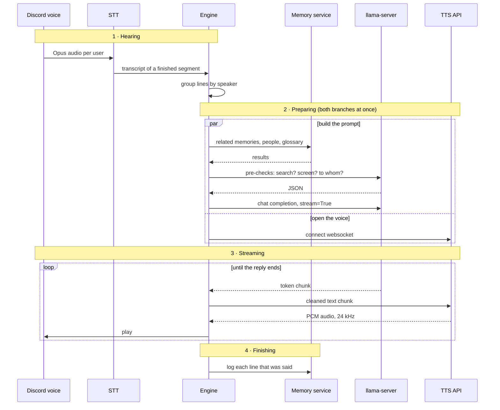

---
hide:
  - toc
---

# How a reply is made

What the Engine does between someone speaking in a voice call and Ohm answering. The text-chat path is the same work in a simpler order and is described [at the end](#a-text-message-instead).

## 1 · Hearing

- Discord sends Opus audio per user. A silence generator fills the gaps so the end of someone's speech can be detected.
- Silero VAD finds the end of a segment and Parakeet transcribes it. The models are loaded once and shared.
- `listen_worker` collects the lines that arrive together and groups them by speaker.
- **Barge-in.** If someone talks for 600 ms (`BARGE_IN_MS`) while Ohm is playing audio, playback pauses right away. Once the transcript is in, `classify_interruption` (a regex, no LLM) decides what it was:

    | Verdict | What happens |
    |---|---|
    | ignore | A "yeah" or "mhm". Playback resumes |
    | stop | Ohm was told to be quiet. The reply is cancelled and his mood takes note |
    | anything else | The reply is cancelled, the unheard part is thrown away, and the new line is answered |

- The reply runs as its own task, so the loop goes straight back to listening.

## 2 · Preparing

Two things run at the same time: building the prompt, and opening the websocket to the TTS API with the character's voice clip.

Building the prompt (`make_stream_response`, on a worker thread so blocking HTTP stays off the event loop):

1. **Memories.** An embedding search on the NAS for what was just said. If the NAS is unreachable this comes back empty and the reply goes ahead.
2. **People.** Notes on each person named in the line.
3. **Pre-checks.** One small JSON call to llama-server: does this need a web search, is it about the screen, and who is it addressed to. Skipped for very short lines.
4. **Screen**, only if the pre-check says so: a screenshot and OCR of the front window. It never leaves the PC.
5. **Web search**, only if the pre-check says so. The query and results show up on the Dashboard.
6. **Glossary.** Slang and game names from the Curator's terminology that appear in the recent lines.

The prompt is then: the character's personality and voice prompt, the channel history, and one note on the newest line holding the addressee aside, the mood line, glossary, the current brief, people, memories, and any web or screen results.

The completion is requested with `stream=True`, a stop sequence at every speaker label, and at most 120 tokens (`VOICE_MAX_TOKENS`, about 20 seconds of speech).

## 3 · Streaming

Feeding text to the TTS API and receiving audio from it run together rather than taking turns.

- Each token chunk passes through `VoiceTagFilter`, which keeps tags like `[laugh]` and `[sigh]`, and drops `*stage directions*` and a leading speaker label. `AtFilter` turns `@lenk` into `lenk`.
- Cleaned chunks go to the TTS websocket; raw PCM comes back and is played into the call from the first chunk on.
- An interruption cancels the task, which closes the LLM stream and the websocket.

## 4 · Finishing

This runs even when the reply was cut off.

- The reply is cleaned (`clean_reply`) and added to the channel history together with the lines it answered. Only what Ohm actually got to say is kept.
- Each line is logged to the NAS. This is the record that [reflection](Curator/reflection.md) reads later.
- The brief and the mood are told what was said.

## Always running alongside

| Loop | How often | What it does |
|---|---|---|
| Brief timer | every 30 s | A channel with 12 new user lines, or whose oldest line is 4 minutes old, is summarised through the Brain (Codex, then the local model). The summary stays in prompts for 10 minutes, and notes on people are stored on the NAS |
| Idle worker | every 1 s | After 10 quiet seconds (`IDLE_SECONDS`) Ohm may say one short thing on his own, depending on his mood. Once per silence |
| Watch worker | every 5 s, vision on | Compares a small grayscale thumbnail of the screen. Enough change during a quiet call and Ohm comments on a cropped screenshot |

## A text message instead

`on_message` calls `make_response`, which does the same preparation as section 2, one step after another. The reply is generated in one piece rather than streamed, cleaned with `clean_reply`, stripped of voice tags, and sent as a Discord reply.
