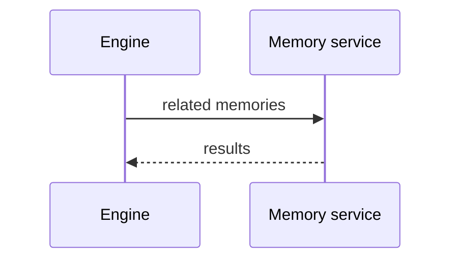

# Writing these docs

The site is built from the Markdown in `Documentation/` by [Material for MkDocs](https://squidfunk.github.io/mkdocs-material/). Its settings are in `mkdocs.yml` at the repo root.

## Preview

```
uvx --with mkdocs-material mkdocs serve
```

Run it from the repo root, then open `http://127.0.0.1:8900`. The page reloads when a file is saved. (Port 8000 belongs to the TTS API.)

## Adding a page

1. Add a `.md` file under `Documentation/`.
2. Add it to `nav:` in `mkdocs.yml`.

The pages under `Documentation/apps/` are one line each: they pull in that app's own `README.md`, so the README stays the only copy.

## Diagrams

### Mermaid, for sequences and flows

Write the diagram as text in a `mermaid` code block. It is drawn in the browser and follows the light and dark theme.

````

````

Sequence diagrams, flowcharts and state diagrams work well. The [Mermaid live editor](https://mermaid.live) is the quickest way to try one.

### Hand-placed SVG, for the architecture picture

Mermaid lays boxes out on its own, which gets messy when many arrows cross. The diagram on the [Architecture](architecture.md) page is an SVG written straight into the page, so every box sits where it was put. Its colours come from `stylesheets/diagrams.css`:

| Class | Used for |
|---|---|
| `od-box`, `od-inner` | A service, and a part inside one |
| `od-t`, `od-s`, `od-l` | Title, subtitle and small label text |
| `od-live`, `od-mem`, `od-bg`, `od-ctl` | The four kinds of arrow |

### A drawing tool

For a diagram drawn by hand, export it as SVG and link it like any image: ``. [draw.io](https://www.drawio.com) gives straight lines and right-angle arrows; a file saved as `.drawio.svg` can be both shown on the site and reopened for editing.
