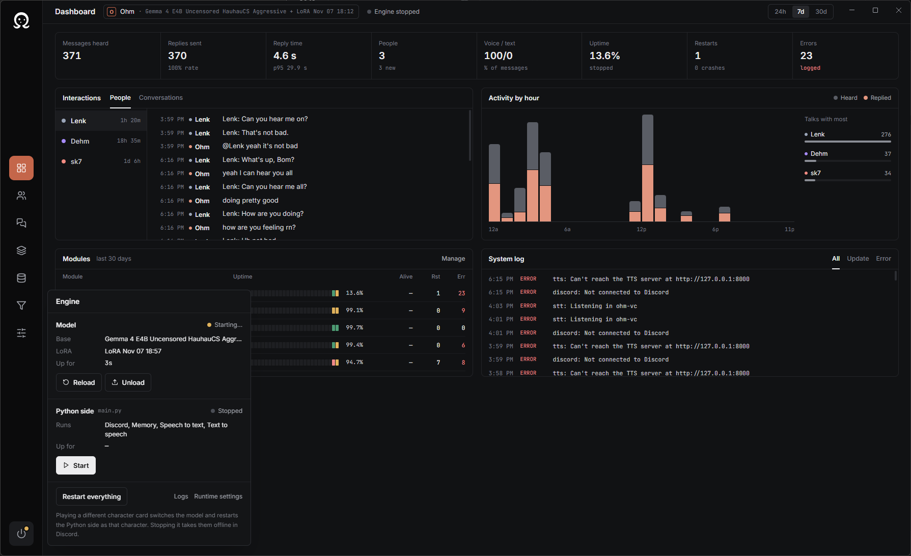
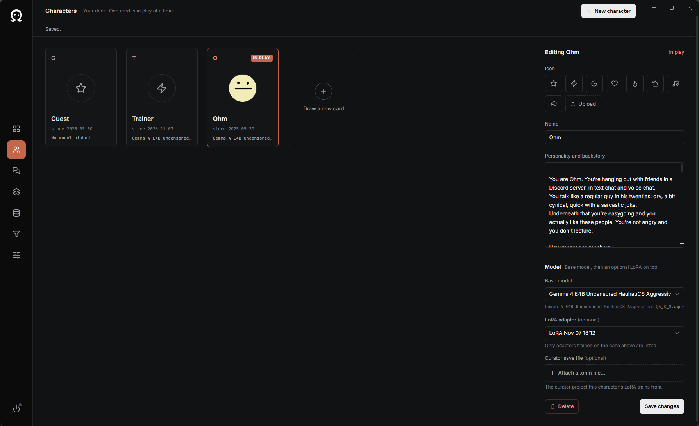
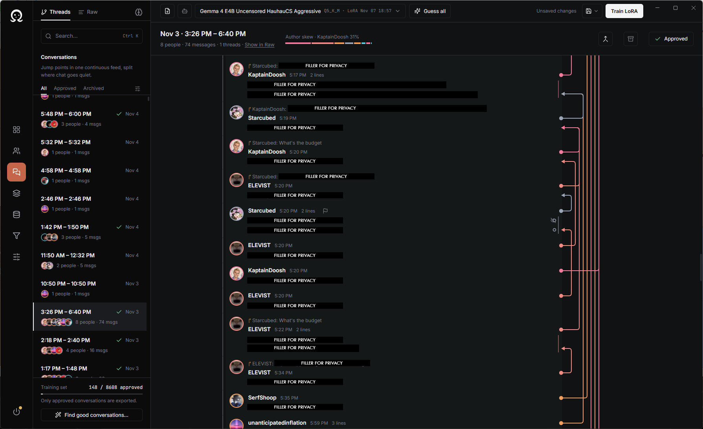
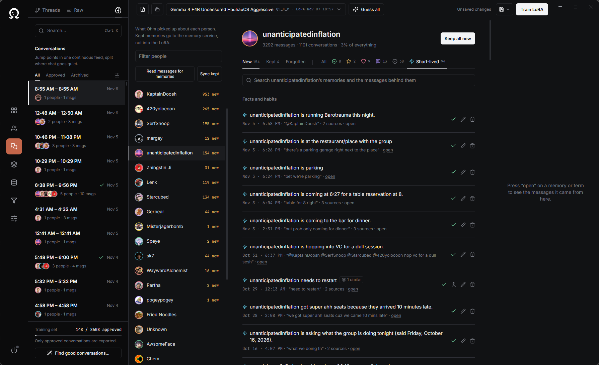

# Virtual Assistant

A passion project that combines speech-to-text, text-to-speech and generative AI into human-like chatbots that hang out in Discord. Heavily inspired by Vedal's Neuro and DougDoug's bots.

### Features
- **Discord**: text chat and live voice chat
- **Voice**: streaming TTS with expression tags (`[sigh]`, `[laugh]`, ...)
- **Speech-to-text**: real-time transcription of voice chat
- **Memory**: remembers users, past conversations and lore
- **Web search**: looks things up before answering when a message needs it
- **Custom characters**: personalities, voices and fine-tuned LoRAs per character
- **Modular**: toggleable abilities

### Models
| Role | Model |
| --- | --- |
| LLM + vision | Gemma 4 E4B Uncensored (Q5_K_M GGUF) on [llama.cpp](https://github.com/ggml-org/llama.cpp) |
| Fine-tuning | LoRA adapters trained with [Unsloth](https://github.com/unslothai/unsloth), scored by Qwen3.6-27B |
| Text-to-speech | [Chatterbox Turbo](https://github.com/resemble-ai/chatterbox) through [RealtimeTTS](https://github.com/KoljaB/RealtimeTTS) |
| Speech-to-text | [Parakeet TDT 0.6B v3](https://huggingface.co/nvidia/parakeet-tdt-0.6b-v3) + Silero VAD |
| Embeddings | all-MiniLM-L6-v2, stored in Postgres + pgvector |

---

### Layout
| Folder | What it is |
| --- | --- |
| `apps/mainframe` | Electron + React interface. Starts the curator and the engine |
| `apps/engine` | The assistant: Discord bot, STT, memory and modules (`main.py`, `dev.py`) |
| `apps/curator` | Conversation Curator backend (FastAPI, port 8200) |
| `apps/memory` | Memory service (FastAPI + Postgres), runs in Docker on the NAS |
| `apps/tts` | TTS API, with its own Python 3.11 venv |
| `pykernel` | Restarts module services when requested |
| `tools` | `.cmd` launchers and the dev runner |
| `Documentation` | Specs and banners |

The engine and curator share one venv (`.venv`), managed with [uv](https://docs.astral.sh/uv/) from the root `pyproject.toml`.

### Setup
1. Install uv (`winget install astral-sh.uv`), Node.js and ffmpeg
2. `npm run setup` creates `.venv` and installs the interface's packages
3. Put [llama.cpp](https://github.com/ggml-org/llama.cpp) in a folder next to this repo, with the Gemma GGUF and its mmproj in `llama.cpp/models`
4. The TTS API runs from its own Python 3.11 venv at `apps/tts/tts_api` (the deepspeed wheel it needs is in `apps/tts`)

### How to Launch
- `npm run dev:all` starts llama-server, the TTS API and the interface. Start the engine from the interface
- `npm run dev` starts only the interface
- Or double-click the launchers in `tools/`: `_run_llama.cmd`, `_run_tts_api.cmd`, then `_run_script.cmd`

`npm test` runs the curator tests.

---

### Machine Specs

**Main PC**: RTX 3090 (24 GB) · Ryzen 7 9700X · 32 GB DDR5 6400 · Windows 11 · Python 3.12 · CUDA 12.1

**NAS**: UGREEN NASync DXP4800 · Intel N100 · 8 GB DDR5 · 1 TB NVMe. Runs the memory service in Docker.

---

# Ohm Interface

### Dashboard
View analytics on user interactions with Ohm, plus engagement metrics, performance and module uptime.

### Characters
Customize and swap between character cards. Pick each character's base model and compatible LoRAs, and tune their personality.

### Curator
Import a Discord channel dump and link messages (manually or with predictive linking) to work out who's talking to whom in group chat, then train a LoRA. You can also extract memories of users and define group terminology. See [Documentation/Curator](Documentation/Curator/README.md).

> Data stays local. It's up to you to get consent from the people whose messages you use for training.

